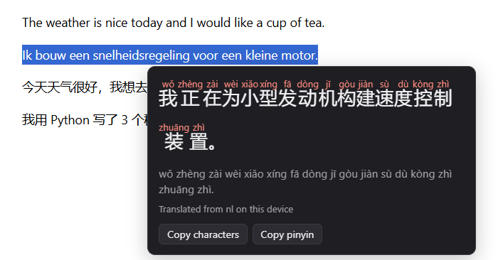

# Mandarin Selection Translator

A Chrome extension: select text on any page and get it in Mandarin, as characters with the pinyin above each one. The translation runs on your own computer with Chrome's built-in translator, so the text you select is not sent to a server and no API key is needed.



Selecting text that is already Chinese skips the translation and adds the pinyin, which makes it a reading aid as well.

## Using it

1. Select text. A small `中 Translate` button appears next to the selection.
2. Click it. A panel shows the characters with pinyin above them, a line of plain pinyin, a **Listen** button that reads the Chinese aloud, and buttons to copy the characters or the pinyin.
3. Press Escape or click elsewhere to close it.

The same action is in the right-click menu (`Translate "…" to Mandarin`), and the toolbar icon opens a small window for typed text. A checkbox there switches to traditional characters.

The first translation from a new language downloads a language model. Chrome does that only after a click, and the panel shows the progress.

## Install

Requires Chrome 138 or newer on desktop. It also runs in Microsoft Edge, where it was tested (version 156).

1. Download or clone this repository.
2. Open `chrome://extensions` (in Edge: `edge://extensions`) and switch on **Developer mode**.
3. Click **Load unpacked** and choose the repository folder.

## How it works

```
 selection ──> content script ──────────────> panel in a shadow root
                 │  LanguageDetector            ▲
                 │  Translator (on device)      │ characters + pinyin
                 ▼                              │
               Chinese text ──> service worker ─┘
                                pinyin-pro
```

| File | Role |
|---|---|
| `src/core.js` | Pure logic: text checks, choice of source language, pinyin layout. No DOM, no `chrome.*`. |
| `src/translate.js` | Language detection and translation with the built-in APIs, with deadlines and error codes. |
| `src/panel.js` | Renders the result. Shared by the in-page panel and the popup. |
| `src/content.js` | Selection button and panel on web pages. |
| `src/background.js` | Service worker: context menu and pinyin conversion. |
| `src/popup.*` | Toolbar popup, also used as a fallback window. |
| `vendor/pinyin-pro.js` | [pinyin-pro](https://github.com/zh-lin/pinyin-pro) 3.29.5, MIT licence. |

## Design notes

**The translator runs in the page, the dictionary does not.** Chrome's Translator API exists only in windows, not in workers, so it has to be called from the content script. The pinyin dictionary is 320 kB. Loading that into every open tab would be wasteful, so it lives in the service worker and the content script asks for the result with a message.

**Pinyin comes from a dictionary, not from the translator.** The translator returns characters only. `pinyin-pro` converts them and resolves characters with several readings from their context: 行 is `háng` in 银行 and `xíng` in 行走. That case is a unit test.

**The page cannot touch the panel and the panel cannot touch the page.** The UI is in a closed shadow root, so page CSS does not restyle it. Everything that comes from the page or the translator is inserted as text, never as HTML.

**It never waits forever.** A browser can expose the translator API without having any language models. In that situation the API calls do not fail, they simply never answer. Every step has a deadline, and the panel shows an error instead of a spinner. This was found while testing in an embedded Chromium, and it is a unit test now.

**The voice has to be Mandarin, not just Chinese.** Reading aloud uses the browser's speech synthesis. A voice tagged `zh-HK` or `yue` speaks Cantonese and would pronounce the same characters differently from the pinyin on screen, so those are never chosen. Mainland voices are preferred over Taiwan voices, and between equal voices a local one wins over an online one. The panel names the voice it uses and says when it is an online voice, because then the Chinese text does leave the computer.

**Short selections are hard to identify.** Language detection is unreliable for a few words. When the detector is not confident, the extension uses the language the page declares, and English after that.

## Tests

```bash
npm test
```

33 tests with the Node test runner, without a browser: the pinyin layout, the choice of source language and of the voice, and `translate.js` against fake `Translator` and `LanguageDetector` objects, including the timeout and the user-activation error.

`test/harness.html` runs the real content script on a test page with the extension APIs stubbed, which is quicker than reloading the extension while working on the UI:

```bash
python -m http.server 8000
# open http://localhost:8000/test/harness.html
```

## Permissions

| Permission | Why |
|---|---|
| Content script on all sites | The button has to appear wherever text is selected. The script reads the selection only after you select something, and sends it nowhere. |
| `contextMenus` | The right-click entry. |
| `storage` | Remembers the traditional/simplified choice. |

The extension makes no network requests itself. The browser downloads the language models, and reading aloud with an online voice sends the Chinese text to the provider of that voice (Microsoft in Edge, Google in Chrome). Translation and pinyin stay on the device.

## Limits

- Desktop Chrome 138 or newer, or a recent desktop Edge. Firefox, Safari and mobile browsers do not have the built-in translator.
- Reading aloud needs a Mandarin voice. Edge and Chrome ship online ones; without any, the panel says so.
- Text inside iframes and in PDF documents does not get the button. The right-click menu opens the translator window in those cases.
- Selections are limited to 1000 characters.
- Translation quality is that of Chrome's on-device model, which is weaker than the online Google Translate, especially for single words without context.
- Pinyin is per character. Tone changes in running speech (不 before a fourth tone, a third tone before another third tone) are not applied.

## License

MIT. The bundled pinyin-pro library is MIT licensed, see `vendor/pinyin-pro.LICENSE`.
